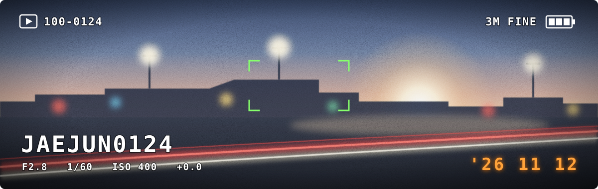

<p align="center">
  
</p>

```text
FILE     DSC_0124.JPG
OWNER    Hwang Jaejun
MODE     Student developer
FOCUS    Mobile apps · Web front-end
SUBJECT  Formula 1 · Race data · Small tools
```

## ▶ Projects

| Frame | Project | Subject | Stack |
| :-- | :-- | :-- | :-- |
| `DSC_0001` | Tailor shop manager · Private | CRM/PWA for customers, schedules and rentals · 79 customer records (Nov 2026) | TypeScript · PWA |
| `DSC_0002` | Hype-Free · Private | Hype-aware portfolio optimization · [conference paper (Aug 2026)](https://www.earticle.net/Article/A493109) | Flutter Web · FastAPI · Oracle |
| `DSC_0003` | [defect-sorting](https://github.com/JAEJUN0124/defect-sorting) | Operator HMI for a conveyor and robot-arm defect sorting line | React · Vite · WebSocket |
| `DSC_0004` | [f1-strategy-simulator](https://github.com/JAEJUN0124/f1-strategy-simulator) | F1 tyre strategy simulator | Flutter · FastAPI · FastF1 |
| `DSC_0005` | [F1-Strategy-Optimizer](https://github.com/JAEJUN0124/F1-Strategy-Optimizer) | Concept and screens for the strategy simulator | Design |
| `DSC_0006` | [Trading-Journal-App-Design](https://github.com/JAEJUN0124/Trading-Journal-App-Design) | Trading journal with performance analytics | React · TypeScript · Recharts |
| `DSC_0007` | [Project_Apple_Eye](https://github.com/JAEJUN0124/Project_Apple_Eye) | Screen-reading puzzle helper with an on-screen overlay | Python · PyQt5 |
| `DSC_0008` | [figure-project](https://github.com/JAEJUN0124/figure-project) | Next up | — |

## ▶ Publication

Hwang, J., Kim, M. (2026). 투자 과열 종목을 제한한 섹터별 밸류에이션 기반 포트폴리오 최적화 시스템 구현 (Implementation of a Sector-Based Valuation Portfolio Optimization System That Restricts Overheated Stocks). *한국정보통신설비학회 2026 하계학술대회*, pp. 93–97. [earticle](https://www.earticle.net/Article/A493109)

## ▶ Stack

<p>
  
  
  
  
  
  
  
  
</p>

## ▶ Contact

`jaejuno123w@gmail.com`

<p align="center"><sub>F2.8 · 1/60 · ISO 400 · '26 11 12</sub></p>
